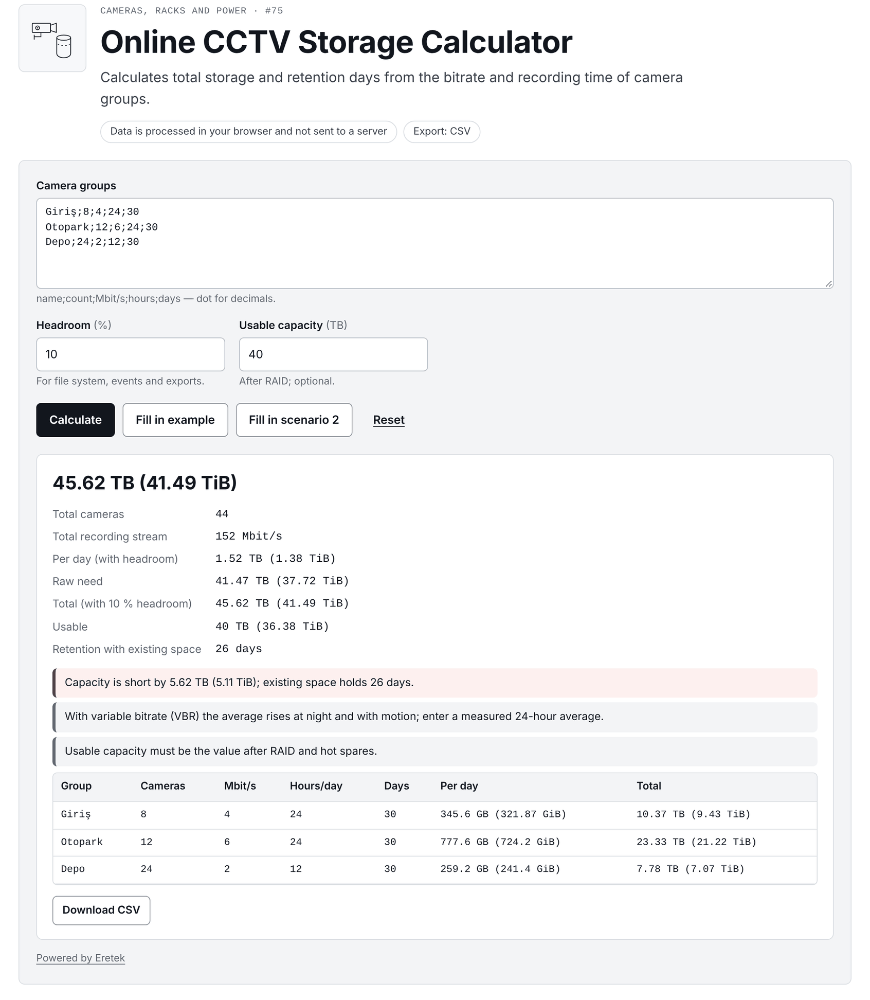

# CCTV Storage Calculator

Calculate NVR/VMS disk capacity from camera count, bitrate (Mbit/s), recording hours per day and retention days, and how many days an existing disk holds.

## Try it live

- [Türkçe](https://kamera.eretek.com/araclar/cctv-disk-hesaplama)
- [English](https://kamera.eretek.com/en/tools/cctv-storage-calculator)
- [Deutsch](https://kamera.eretek.com/de/werkzeuge/videoueberwachung-speicherbedarf)



## What it does

Calculates total storage and retention days from the bitrate and recording time of camera groups.

Recording space is driven by bitrate, not resolution. The same 4 MP camera may produce 2 Mbit/s with H.265 on a static scene and 8 Mbit/s with night noise or motion. The tool calculates daily and total space per group, adds file system/event headroom and shows how many days existing disk capacity lasts.

## Where it helps

Get usable capacity from the RAID Capacity Calculator (not the disk label). Use the CCTV Bandwidth Calculator for network load and the CCTV Project Capacity Summary for PoE and totals.

## How to use it

1. Enter one camera group per line: `name;cameras;Mbit/s;hours/day;days`.
2. Enter headroom (%) and, if known, the NVR's usable capacity (TB after RAID).
3. Press Run; download the table as CSV.

### Fields

| Field | Description |
|---|---|
| Camera groups | name;count;Mbit/s;hours;days — dot for decimals. |
| Headroom | For file system, events and exports. |
| Usable capacity | After RAID; optional. |

## Example input

Press **Fill in example** in the tool to load this input.

| Input | Value |
|---|---|
| Headroom | `10` |
| Usable capacity | `40` |

**Camera groups**

```text
Giriş;8;4;24;30
Otopark;12;6;24;30
Depo;24;2;12;30
```

**Expected result:** 44 cameras, 1.52 TB per day (with headroom), 45.62 TB needed for 30 days; 40 TB usable lasts 26 days.

## Method and assumptions

Bytes = cameras × Mbit/s × 10<sup>6</sup> / 8 × hours × 3600 × days. Total = Σ groups × (1 + headroom). Possible days = usable / daily total with headroom, rounded down.

## Limits and common mistakes

- With motion recording real space depends on scene activity; continuous recording is assumed here (approximate by scaling hours). Sub-stream recording must be entered as a separate group.

## Run it locally

The tool is plain HTML, CSS and JavaScript with no build step and no dependencies.

```bash
git clone https://github.com/eretek/cctv-storage-calculator.git
cd cctv-storage-calculator
node scripts/serve.js        # or: python3 -m http.server 8080
```

Open <http://127.0.0.1:8080/>. Add `?lang=tr` or `?lang=de` for Turkish or German; without it the page follows the browser language and falls back to English. You can also open `index.html` directly from disk.

Run the tests (Node.js 18 or later):

```bash
node test/run.js    # or: npm test
```

The tests run the tool's own fixtures and the worked examples in all three languages without a browser.

## How it works

All processing happens in your browser. The tool makes no network requests, uses no cookies or browser storage, and does not upload files you select.

No server-side component is needed. The version on the Eretek website renders the same page through a private WordPress plugin; that plugin only produces the page markup and is not part of this repository.

| Path | Purpose |
|---|---|
| `index.html` | Page shell |
| `src/app.js` | Builds the page in Turkish, English or German from `src/data.js` |
| `src/data.js` | Field definitions, examples and all texts in three languages |
| `src/core.js` | Shared runtime: validation, number formats, result rendering, CSV/ICS export |
| `src/tool.js` | The calculation or analysis for this tool |
| `docs/screenshot.png` | Screenshot used in this README |
| `src/lib/cctv.js` | PoE and CCTV capacity engines |
| `src/tools.css`, `src/page.css` | Styles |
| `test/run.js`, `test/cases.json` | Headless tests |

## License and attribution

This tool is released under the [Eretek Website Attribution License](LICENSE). You may use, modify and redistribute it, including commercially. If you make it available on a website or web application, show a visible, clickable credit linking to https://eretek.com/ on every page where the tool is available, for example:

```html
<a href="https://eretek.com/">Powered by Eretek</a>
```

You may add `rel="nofollow"` to the link. Keep the copyright notice and license text in copies and redistributions.
